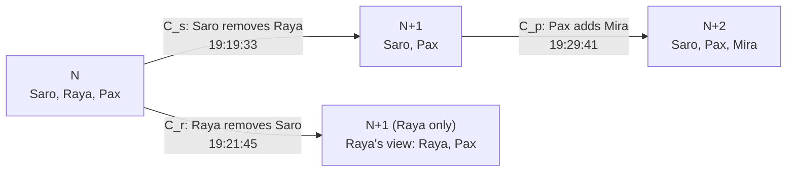

# ForkReport: a member finalized a commit by itself

## Overview

| | |
| --- | --- |
| Date | 2026-11-20 |
| libchat | `ce916b8` |
| Network | `logos.dev` |
| Conversation | `680a09f4b0fc8923635925b5bd070716` |
| Kind | Missed commit |
| Split | At epoch N, into two N+1s: `C_s` (Saro) and `C_r` (Raya) |
| Branches | Main: Saro and Pax, then Mira at N+2. Orphan: Raya alone |
| Detected by libchat | No |
| Recovery | Not attempted: the test clients don't call `group_request_readd` |
| Connection issues | Yes: Raya received nothing from this group, 19:13:05–19:23:37 |

## Summary

Saro removed Raya (`C_s`). Raya never applied it. Still at epoch N, 10 s after Saro and Pax had finalized `C_s`, Raya removed Saro (`C_r`), finalized it alone and stayed on that branch.

Facts:

1. **Delivery:** Pax finalized `C_s` 1.2 s after Saro did. Raya never applied `C_s`, and its store queries timed out before and after `C_s` was sent.
2. **Finality:** Raya committed `C_r` 10 s after Saro and Pax had finalized `C_s`. It finalized `C_r` at its own timeout, holding no other commit.
3. **Detection:** Raya logged no `fork detected`, and its `can_send()` stayed true.

## Environment

| | |
| --- | --- |
| Network | `logos.dev` preset; one embedded logos-delivery node per client; all clients on one host |
| Registry | `https://devnet.chat-kc.logos.co` |
| Client state | In memory |
| Load | About 1 message per minute per client; random adds and removes |
| Network health | 561 sends not confirmed by a store node, and 69 store query timeouts, across all clients by 19:25; 5 store peers failing to dial |

## Members

| Member | Role | logos-chat | Branch at the end |
| --- | --- | --- | --- |
| Saro | Initiator: removes Raya (`C_s`) | `ce916b8` | Main: N+1, then N+2 |
| Raya | Recipient: misses `C_s`; removes Saro (`C_r`) | `ce916b8` | Orphan: its own N+1 |
| Pax | Third party: applies `C_s`; adds Mira (`C_p`) | `66fefb9` (before #357) | Main |
| Mira | Joins at N+2 | `ce916b8` | Main |

## Connectivity

**Connection issues: yes.** The fault was limited to Raya receiving this group's traffic. For 10.5 min, 19:13:05–19:23:37, Raya received nothing from Saro or Pax, while it kept sending to this group and receiving another. `C_s` was sent inside that gap.

| | Saro | Raya | Pax |
| --- | --- | --- | --- |
| Active on host: not asleep or suspended | ✓ | ✓ | ✓ |
| Receiving this group live | ✓ | ✗ 19:13:05–19:23:37 | ✓ |
| Receiving other groups during the gap | not checked | ✓ | not checked |
| Its sends to this group delivered | ✓ | ✓ | ✓ |

- **Active on host:** all clients share one host, which didn't sleep from 18:49:42 to after 19:45, per its `pmset` log. Each client kept acting through the gap:
    - Raya sent at least every 2.5 min, from 19:13:26 to 19:22:22, and committed `C_r` at 19:19:44.
    - Saro sent at 19:14:10 and 19:16:24, and committed `C_s` at 19:17:33.
    - Pax sent at 19:14:03, and finalized `C_s` at 19:19:34.
- **Live in this group:** Saro and Pax received each other's messages, and Raya's, within 1.2 s throughout. Raya's last receipt from either was Saro's message 29, at 19:13:05.587. It then missed four messages, each of which reached the other member within 1.2 s:
    - Pax's message 38, at 19:14:03
    - Saro's message 31, at 19:14:10
    - Saro's message 34, at 19:16:24
    - `C_s`, at 19:17:33

  Raya's next receipts came at 19:23:37.946: two messages, both undecryptable after the fork. Its store queries timed out at 19:14:20, 19:16:35, 19:17:44, 19:22:02 and 19:22:49, so none of them filled the gap.
- **Other groups:** in `678f84665e94`, Raya received Mira's messages 6–19 between 19:13:26 and 19:21:58, all inside the gap. Mira numbers its messages in sequence and none is missing, so Raya got every one. Raya's own messages there reached Mira within 1 s.
- **Sends:** Raya's messages to this group at 19:15:22 and 19:17:42 reached Saro and Pax within 1 s. Its later ones can't be judged, because the others were at N+1 from 19:19:33.
- **What "received" means:** the message was delivered and decrypted. A missing receipt can mean it was never delivered or that SDS held it; debug logs would tell which.

## Commits

| Commit | Sender | Published at | Epoch | Saro | Raya | Pax | Outcome |
| --- | --- | --- | --- | --- | --- | --- | --- |
| `C_s`: remove Raya | Saro | 19:17:33.406 | N → N+1 | Finalized 19:19:33.511 | Never applied | Finalized 19:19:34.697 | Won: main branch |
| `C_r`: remove Saro | Raya | 19:19:44.513 | N → N+1 | Not applied | Finalized 19:21:45.359 | Not applied | Orphaned: Raya only |
| `C_p`: add Mira | Pax | ≈19:27:40.8 | N+1 → N+2 | Finalized 19:29:41.854 | Failed to decrypt, 19:27:40.915 | Finalized 19:29:40.832 | Won; Mira joined 19:29:42.307 |

N is counted from the commits, since epochs weren't recorded. ≈ = inferred as finalize time − 120 s.

## Finality windows

| Member | Started at | Started by | Commits held | Chosen | Finalized at | Early, on a later-epoch message? |
| --- | --- | --- | --- | --- | --- | --- |
| Saro | 19:17:33.4 | Its own `C_s` | `C_s` | `C_s` | 19:19:33.5 | No |
| Pax | ≈19:17:34.6 | Receiving `C_s` | `C_s` | `C_s` | 19:19:34.7 | No |
| Raya | 19:19:44.5 | Its own `C_r` | `C_r` | `C_r` | 19:21:45.4 | No |

`COMMIT_FINALIZE_TIMEOUT` is 120 s.

```mermaid
gantt
    title Finality windows, 2026-11-20 UTC
    dateFormat HH:mm:ss
    axisFormat %H:%M:%S
    section Saro
    holds C_s        :s1, 19:17:33, 120s
    section Pax
    holds C_s        :p1, 19:17:35, 120s
    section Raya
    holds C_r only   :crit, r1, 19:19:44, 121s
```



## After the fork

| | Saro | Raya | Pax |
| --- | --- | --- | --- |
| `can_send()` | true | **true**: removed, so expected false | true |
| [`fork detected`](https://github.com/logos-messaging/libchat/blob/ce916b886f0379968804b7e62b154c4d5348e4bf/core/conversations/src/conversation/group_v3.rs#L607) logged | No | **No** | No |
| `SyncState` | Not recorded | Not recorded | Not recorded |
| Decryption failures in this group | None | 3: 19:23:37 ×2, 19:27:40 | None | 

## Timeline

UTC. ≈ = inferred.

| Time | Member | Event | State after |
| --- | --- | --- | --- |
| 19:01:10 | all | Pax joins; all three at N | N: {Saro, Raya, Pax} |
| **19:17:33.406** | **Saro** | **`remove_group_participants([Raya])`, so `C_s` is pending** | |
| ≈19:17:34.6 | Pax | Receives `C_s` | |
| 19:19:33.511 | Saro | Finalizes `C_s` | N+1: {Saro, Pax} |
| 19:19:34.697 | Pax | Finalizes `C_s` | N+1: {Saro, Pax} |
| **19:19:44.513** | **Raya** | **At N with `can_send()` true: `remove_group_participants([Saro])`, so `C_r` is pending** | |
| **19:21:45.359** | **Raya** | **Finalizes `C_r`, the only commit it holds** | **Raya's N+1: {Raya, Pax}, forked** |
| 19:23:37.946 | Raya | Receives 2 of the group's N+1 messages; both fail sender-data decryption | |
| ≈19:27:40.8 | Pax | Adds Mira, so `C_p` is pending | |
| 19:27:40.915 | Raya | Receives `C_p`; it fails sender-data decryption | |
| 19:29:40.832 | Pax | Finalizes `C_p` | N+2: {Saro, Pax, Mira} |
| 19:29:41.854 | Saro | Finalizes `C_p` | N+2 |
| 19:29:42.307 | Mira | Joins | N+2 |



## Analysis

- **`C_r` could never win.** `finality::Timeout` agrees only when every member defers the same commits before its own timeout. Raya's window opened 10 s after Saro's and Pax's had closed.
- **`C_s` hadn't reached Raya by 19:19:44.** If it had, Raya's window would have started on receipt, and Raya would have finalized `C_s` with its peers.
- **A late `C_s` wouldn't have helped.** Inside Raya's window, it finalizes `min(C_s, C_r)`. If `C_r` is lower, Raya still forks, because its peers have already finalized.
- **An N+1 message inside Raya's window makes it worse:** `later_epoch_seen` makes Raya finalize `C_r` at once.
- **After the fork,** Raya's epoch number equals the group's. Group traffic therefore passes the epoch checks in [`handlers.rs:117-134`](https://github.com/logos-messaging/libchat/blob/ce916b886f0379968804b7e62b154c4d5348e4bf/core/conversations/src/conversation/group_v3/handlers.rs#L117-L134) and fails sender-data decryption. A late `C_s`, at epoch N, is dropped as past-epoch at debug level.

## Questions

1. **Delivery.** Why did Raya stop receiving this group at 19:13, while still receiving another group and still able to send to this one? `C_s` was sent 4.5 min into the gap.
    - Did Raya's subscription to this group's delivery address lapse?
    - Did Raya's SDS report missing messages (`MissingDependencies` → `fetch_missing`)?
    - Were Raya's store timeouts, starting 17 s after the first missed message, those fetches?
2. **Committing while behind.** If Raya held messages with missing dependencies, or anything in `later_epoch_msgs`, at 19:19:44, it knew it was behind and committed anyway. Should a local commit be deferred or refused in that state?
3. **Finality agreement.** A member can finalize a commit no peer deferred. Options:
    - Before finalizing a local commit, require evidence that peers hold it, such as beacons or acks.
    - Make that finalization provisional, and roll it back on a conflicting later-epoch message.
4. **`later_epoch_seen`.** It finalizes the lowest held commit even when the group's choice isn't held. See the TODO at [`finality.rs:19`](https://github.com/logos-messaging/libchat/blob/ce916b886f0379968804b7e62b154c4d5348e4bf/core/conversations/src/conversation/group_v3/finality.rs#L19) (use the fork-detection fingerprint instead of the epoch), and [`handlers.rs:123`](https://github.com/logos-messaging/libchat/blob/ce916b886f0379968804b7e62b154c4d5348e4bf/core/conversations/src/conversation/group_v3/handlers.rs#L123) (the epoch is unverified).
5. **Detection.** No `fork detected` from Raya in 8 minutes. Detection is beacon-only ([`observe_beacon`, `group_v3.rs:599-609`](https://github.com/logos-messaging/libchat/blob/ce916b886f0379968804b7e62b154c4d5348e4bf/core/conversations/src/conversation/group_v3.rs#L599-L609)).
    - Should repeated sender-data decryption failures at the member's own epoch feed `SyncState`?
    - Why didn't Raya verify any beacon from Saro or Pax?
    - Detection does fire elsewhere: another group logged `Forked { at_or_before: 6 }` at 15:00:49.
6. **A removed member's state.** Raya was removed, yet its `can_send()` stayed true, and it kept sending into a branch no one else is on.
7. **A pending removal is invisible for 120 s.** `pending_members` lists invitees only, so neither peers nor the member being removed can avoid a conflicting commit.
8. **A stale doc comment.** [`crates/generic-chat/src/client.rs:256`](https://github.com/logos-messaging/libchat/blob/ce916b886f0379968804b7e62b154c4d5348e4bf/crates/generic-chat/src/client.rs#L256) still says GroupV3 can't remove members.

## Reproducing

Unlike the existing fork tests, one peer receives the commit and one doesn't, and the one that doesn't commits after the others have finalized. The sketch hasn't been compiled:

```rust
#[test]
fn a_member_that_misses_its_removal_forks() {
    let mut h = TestHarness::<4>::new(|_, _| {});
    let convo = create_group_for_adds(&mut h); // Saro + Raya
    let pax = h.pax().account();
    h.saro().group_add_participants(&convo, std::slice::from_ref(&pax)).unwrap();
    settle(&mut h); // N: Saro, Raya, Pax

    let raya = h.raya().account();
    h.saro().group_remove_participants(&convo, &[raya]).unwrap();
    h.client_mut(RAYA).drop_pending_payloads(); // Raya misses C_s; Pax doesn't
    settle(&mut h); // Saro, Pax at N+1
    assert!(h.raya().can_send(&convo));

    let saro = h.saro().account();
    h.raya().group_remove_participants(&convo, &[saro]).unwrap(); // C_r at N
    h.tolerate_inbound_errors();
    settle(&mut h);

    // Today:
    assert_ne!(
        h.raya().debug_data(&convo).unwrap()["epoch_fingerprint"],
        h.pax().debug_data(&convo).unwrap()["epoch_fingerprint"],
    );
    // Expected, one of:
    // assert!(!h.raya().can_send(&convo));
    // assert!(matches!(h.raya().group_sync_state(&convo).unwrap(), SyncState::Forked { .. }));
}
```

- If SDS repair or a store fetch delivers `C_s` to Raya in the harness, make those fail too. Live, every store query Raya made timed out.
- **Variation A:** deliver `C_s` to Raya inside its window. Checks `min(C_s, C_r)` choosing a commit its peers have passed.
- **Variation B:** deliver one of Pax's N+1 messages inside Raya's window. Checks that `later_epoch_seen` finalizes `C_r` at once.

## Data available

| Data | Available | Notes |
| --- | --- | --- |
| Per-member commit and membership records | ✓ | |
| Message send and receive receipts | ✓ | 19:10–19:25 checked |
| libchat and delivery warnings and errors | ✓ | 19:00–19:30 |
| Host power log | ✓ | |
| Epoch numbers | Added for future runs | This run: N counted from commits |
| Epoch fingerprints | Added for future runs | |
| Commit receive times | Added for future runs | This run: inferred as finalize − 120 s |
| Debug logs: SDS holds, missing dependencies, finality, past-epoch drops | Added for future runs | |

## Logs

Every warning and error from Saro, Raya and Pax, 19:00–19:30 UTC. Member names are in brackets.

```text
2026-11-20T19:02:11.824Z WARN  [Raya] embedded_logos_delivery: the node failed a send request_id=ce8bb3d0490335b85078 error=Propagated but not confirmed by a store node within the store validation window
2026-11-20T19:02:57.926Z WARN  [Saro] embedded_logos_delivery: the node failed a send request_id=dcc2cbcbfe00de888a17 error=Propagated but not confirmed by a store node within the store validation window
2026-11-20T19:03:22.534Z WARN  [Pax]  embedded_logos_delivery: fetching from the store failed: store query failed: StoreRequest failed store query: storeQuery timed out
2026-11-20T19:04:37.256Z WARN  [Pax]  embedded_logos_delivery: fetching from the store failed: store query failed: StoreRequest failed store query: storeQuery failed: PEER_DIAL_FAILURE: 16Uiu2HAkvwhGHKNry6LACrB8TmEFoCJKEX29XR5dDUzk3UT3UNSE
2026-11-20T19:12:57.288Z WARN  [Pax]  embedded_logos_delivery: the node failed a send request_id=b9a74f7e8210877cde35 error=Propagated but not confirmed by a store node within the store validation window
2026-11-20T19:14:20.693Z WARN  [Raya] embedded_logos_delivery: fetching from the store failed: store query failed: StoreRequest failed store query: storeQuery timed out
2026-11-20T19:16:35.633Z WARN  [Raya] embedded_logos_delivery: fetching from the store failed: store query failed: StoreRequest failed store query: storeQuery timed out
2026-11-20T19:17:44.556Z WARN  [Raya] embedded_logos_delivery: fetching from the store failed: store query failed: StoreRequest failed store query: storeQuery timed out
2026-11-20T19:19:08.726Z WARN  [Pax]  embedded_logos_delivery: fetching from the store failed: store query failed: StoreRequest failed store query: storeQuery failed: PEER_DIAL_FAILURE: 16Uiu2HAkvwhGHKNry6LACrB8TmEFoCJKEX29XR5dDUzk3UT3UNSE
2026-11-20T19:19:20.754Z WARN  [Pax]  embedded_logos_delivery: the node failed a send request_id=2db181182e096da62966 error=Propagated but not confirmed by a store node within the store validation window
2026-11-20T19:19:34.769Z WARN  [Pax]  embedded_logos_delivery: the node failed a send request_id=144dcd5bd1a7fa63d540 error=Propagated but not confirmed by a store node within the store validation window
2026-11-20T19:19:38.775Z WARN  [Pax]  embedded_logos_delivery: the node failed a send request_id=3307ccad9a4dc5403797 error=Propagated but not confirmed by a store node within the store validation window
2026-11-20T19:22:02.080Z WARN  [Raya] embedded_logos_delivery: fetching from the store failed: store query failed: StoreRequest failed store query: storeQuery timed out
2026-11-20T19:22:49.554Z WARN  [Raya] embedded_logos_delivery: fetching from the store failed: store query failed: StoreRequest failed store query: storeQuery timed out
2026-11-20T19:23:06.554Z WARN  [Pax]  embedded_logos_delivery: fetching from the store failed: store query failed: StoreRequest failed store query: storeQuery failed: PEER_DIAL_FAILURE: 16Uiu2HAkvwhGHKNry6LACrB8TmEFoCJKEX29XR5dDUzk3UT3UNSE
2026-11-20T19:23:37.946Z ERROR [Raya] openmls::framing::private_message_in: Sender data decryption error
2026-11-20T19:23:37.946Z WARN  [Raya] libchat::conversation::group_v3::handlers: dropping released message convo=680a09f4b0fc8923635925b5bd070716 error=generic: An error occurred during AEAD decryption.
2026-11-20T19:23:37.946Z ERROR [Raya] openmls::framing::private_message_in: Sender data decryption error
2026-11-20T19:23:37.946Z WARN  [Raya] libchat::conversation::group_v3::handlers: dropping released message convo=680a09f4b0fc8923635925b5bd070716 error=generic: An error occurred during AEAD decryption.
2026-11-20T19:25:34.147Z WARN  [Pax]  embedded_logos_delivery: fetching from the store failed: store query failed: StoreRequest failed store query: storeQuery failed: PEER_DIAL_FAILURE: 16Uiu2HAm8Y9kgBNtjxvCnf1X6gnZJW5EGE4UwwCL3CCm55TwqBiH
2026-11-20T19:25:40.261Z WARN  [Pax]  embedded_logos_delivery: the node failed a send request_id=61cf3da8a628695a3923 error=Propagated but not confirmed by a store node within the store validation window
2026-11-20T19:25:51.275Z WARN  [Pax]  embedded_logos_delivery: the node failed a send request_id=0337224d400d57e5c1c9 error=Propagated but not confirmed by a store node within the store validation window
2026-11-20T19:26:11.825Z WARN  [Saro] embedded_logos_delivery: fetching from the store failed: store query failed: StoreRequest failed store query: storeQuery timed out
2026-11-20T19:27:40.915Z ERROR [Raya] openmls::framing::private_message_in: Sender data decryption error
2026-11-20T19:27:40.915Z WARN  [Raya] libchat::conversation::group_v3::handlers: dropping released message convo=680a09f4b0fc8923635925b5bd070716 error=generic: An error occurred during AEAD decryption.
```

Saro logged nothing between 19:02:57 and 19:26:11, including no failed send after `C_s`.

Store peers that failed to dial that day, across all clients:

```text
16Uiu2HAm8Y9kgBNtjxvCnf1X6gnZJW5EGE4UwwCL3CCm55TwqBiH
16Uiu2HAkvwhGHKNry6LACrB8TmEFoCJKEX29XR5dDUzk3UT3UNSE
16Uiu2HAm8YokiNun9BkeA1ZRmhLbtNUvcwRr64F69tYj9fkGyuEP
16Uiu2HAmTUbnxLGT9JvV6mu9oPyDjqHK4Phs1VDJNUgESgNSkuby
16Uiu2HAm4S1JYkuzDKLKQvwgAhZKs9otxXqt8SCGtB4hoJP1S397
```
