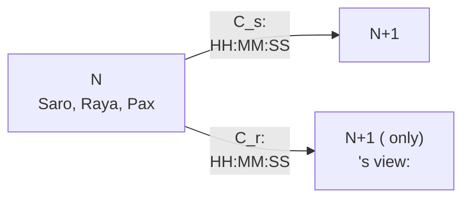

<!--
ForkReport template. Process and rules: README.md in this folder.
- Notes like this one don't render on GitHub. Delete them before publishing anyway.
- <angle brackets> are placeholders.
- Members by role: Saro = initiator, Raya = recipient, Pax = third party. Name no one else: a name says the member took part. Describe the rest ("another member", "the other five") in one shared row or column. Commits: C_s, C_r, C_p.
- Never mention owls, flock, roost, operators, hostnames or local paths.
- Never write #<number> unless it's a real PR or issue: GitHub autolinks it.
-->

# ForkReport: <the finding, stated generically, no member names>

## Overview

| | |
| --- | --- |
| Date | <YYYY-MM-DD> |
| libchat | `<short rev>` |
| Network | `<preset>` |
| Conversation | `<full conversation id>` |
| Kind | <what happened, generically: e.g. "Missed commit: a member never applied a peer's commit, then committed on the stale epoch"> |
| Split | At epoch <N>, into <branches>: `<C_x>` (<member>) and `<C_y>` (<member>) |
| Branches | Main: <members>. Orphan: <members> |
| Detected by libchat | <Yes, at HH:MM:SS by member / No> |
| Recovery | <Not attempted / The app called `request_readd` on <member> at HH:MM:SS: <asked / not asked / failed>, <sync state>; <rejoined `<C_x>`'s branch at HH:MM:SS / didn't rejoin>> |
| Connection issues | <No / Yes: who, which group, which direction, from–to> |
| Later | <Only if the group split again, e.g. "The `C_s` side split again later. Those splits aren't covered here." One split per report> |

## Summary

<One or two sentences: who did what, in order. Facts only.>

Facts:

<!-- Facts are high level, neutral, and observed. No "never reached", "can't win" or other inference: that goes in Analysis. -->

1. **Delivery:** <who applied which commit when; who didn't; any store or delivery trouble>
2. **Finality:** <who committed and finalized what, relative to the others>
3. **Detection:** <fork detected or not; `can_send()` of any removed member>

## Environment

| | |
| --- | --- |
| Network | `<preset>`; one embedded logos-delivery node per client; <host layout, e.g. all clients on one host> |
| Registry | `<registry url>` |
| Client state | In memory |
| Load | About <n> message(s) per minute per client; random adds and removes |
| Network health | <counts of unconfirmed sends, store timeouts and dial failures across all clients, with the time range> |

## Members

| Member | Role | logos-chat | Branch at the end |
| --- | --- | --- | --- |
| Saro | Initiator: <first action in the window> | `<rev>` | <Main / Orphan> |
| Raya | Recipient: <what happened to it> | `<rev>` | <Main / Orphan> |
| Pax | Third party: <role> | `<rev>` <(before #NNN) if it predates a relevant PR> | <Main / Orphan> |

## Connectivity

**Connection issues: <yes / no>. <The takeaway in one plain sentence, e.g. "Raya and Pax stopped receiving this group 15 to 25 minutes before `C_s`.">** <Two or three sentences: who stayed up, what they still received, what they didn't, and which commit fell in the gap.>

<!-- Answers, not data: Yes / No / Mostly / Partly, plus a few words. Counts and times go in the bullets. Named members get a column; everyone else shares one. -->

| | Raya | Pax | Saro and the other <n> |
| --- | --- | --- | --- |
| Up and active on its host | | | |
| Receiving this group live | | | |
| Receiving its other groups at the same time | | | |
| Its own messages reaching this group | | | |

<!-- One bullet per row, in plain words. Tie every claim to the gap: exact times, the last message received from each sender, and other-group counts over the same window. -->

- **Up and active:** <power log, or that each member kept sending, and its longest gap between sends>
- **This group:** <the last message each affected member got from each sender, whether they stopped at the same ones, what they kept receiving>
- **Other groups:** <messages owed and received in their other groups over the same window; a shared group with the silent senders, if there is one>
- **Late batches:** <only if messages arrived in batches: the largest, and how late>

The counts cover messages sent from <HH:MM:SS> to <HH:MM:SS>, before `<C_x>`, while all members were at epoch <N>. "Received" means delivered and decrypted. A missing message may never have been delivered, or SDS may have held it; debug logs would tell which.

## Commits

| Commit | Sender | Published at | Epoch | Saro | Raya | Pax | Outcome |
| --- | --- | --- | --- | --- | --- | --- | --- |
| `C_s`: <what it does> | Saro | <HH:MM:SS.mmm> | N → N+1 | <Finalized HH:MM:SS.mmm / Never applied / Failed to decrypt> | | | <Won / Orphaned> |

<!-- Published at = when the call returned Ok, from the client's own log. ≈ marks inferred times: a receiver's receipt is about its finalize time − 120 s. -->

<Say where N comes from, if epochs weren't recorded.> ≈ = inferred as finalize time − 120 s.

## Finality

| Member | Started at | Started by | Commits held | Chosen | Finalized at | Rule |
| --- | --- | --- | --- | --- | --- | --- |
| Saro | <HH:MM:SS.s> | <Its own `C_s` / Receiving `C_x`> | <commits> | <commit> | <HH:MM:SS.s> | <Timeout / Later epoch: <the message, and how long before>> |

Each member finalizes by one of two rules ([`finality.rs:46-52`](https://github.com/logos-messaging/libchat/blob/ce916b886f0379968804b7e62b154c4d5348e4bf/core/conversations/src/conversation/group_v3/finality.rs#L46-L52)):
- **Timeout:** `COMMIT_FINALIZE_TIMEOUT`, 120 s after the member first deferred a commit.
- **Later epoch:** at once, on receiving a message from a later epoch.

<!-- Keep this paragraph only if a member finalized by the later-epoch rule. -->
Under the later-epoch rule the timer had started less than 120 s before, so "Started at" is a range.

<!-- Optional chart: one bar per member, from Started at, lasting until Finalized at. -->

```mermaid
gantt
    title Finality, <YYYY-MM-DD> UTC
    dateFormat HH:mm:ss
    axisFormat %H:%M:%S
    section Saro
    holds C_s        :s1, <HH:MM:SS>, 120s
    section Raya
    holds C_r only   :crit, r1, <HH:MM:SS>, 120s
```

## After the fork

| | Saro | Raya | Pax |
| --- | --- | --- | --- |
| `can_send()` | | <**true**: removed, so expected false> | |
| [`fork detected`](https://github.com/logos-messaging/libchat/blob/<full sha>/core/conversations/src/conversation/group_v3.rs#L607) logged | | | |
| `SyncState` | <state / Not recorded> | | |
| Decryption failures in this group | <None / n: times> | | |

<!-- Check the fork-detected line number at the pinned commit. -->

## Timeline

UTC. ≈ = inferred.

<!-- Group events only: calls, receipts, finalizations, joins. Logs go in Logs. Bold the rows that make the fork. -->

| Time | Member | Event | State after |
| --- | --- | --- | --- |
| <HH:MM:SS.mmm> | <member> | <event> | <epoch: {members}> |



## Analysis

<!-- Reasoning, checked against libchat's code at the pinned commit. Link each code reference inline: https://github.com/logos-messaging/libchat/blob/<full sha>/<path>#L<a>-L<b> -->

- **<Claim>.** <Why, with the code reference.>

## Questions

<!-- Numbered by priority. Separate the trigger (often delivery), the defect (often finality) and the missing safety net (detection). Raise recovery only if a re-add was requested and went wrong. -->

1. **<Area>.** <Question>
    - <Specific sub-question, with a code reference>

## Reproducing

<How this differs from the existing tests in `core/integration_tests_core/tests/`.> The sketch hasn't been compiled:

```rust
#[test]
fn <what_it_shows>() {
    let mut h = TestHarness::<4>::new(|_, _| {});
    // <setup to epoch N>
    // <the action that splits the group, and the delivery fault: e.g. h.client_mut(RAYA).drop_pending_payloads()>
    // settle(&mut h); // past COMMIT_FINALIZE_TIMEOUT
    // Today: <assertion that holds now>
    // Expected: <assertion that should hold>
}
```

- **Variation A:** <a change that pins down one question>

## Data available

| Data | Available | Notes |
| --- | --- | --- |
| Per-member commit and membership records | <✓ / ✗> | |
| Message send and receive receipts | | <window checked> |
| libchat and delivery warnings and errors | | <window> |
| Host power log | | |
| Epoch numbers | <✓ / Added for future runs> | <This run: how N was worked out> |
| Epoch fingerprints | | |
| Commit receive times | | <This run: inferred as finalize − 120 s> |
| Debug logs: SDS holds, missing dependencies, finality, past-epoch drops | | |

## Logs

Every warning and error from Saro, Raya and Pax, <HH:MM>–<HH:MM> UTC. Member names are in brackets.

<!-- One raw line each, in time order: timestamp, level padded to 5, [Member], target, message. Strip local paths. -->

```text
<YYYY-MM-DDTHH:MM:SS.mmmZ> WARN  [Raya] <target>: <message>
```

<Anything notable about what's absent, e.g. "Saro logged nothing between … and …".>
